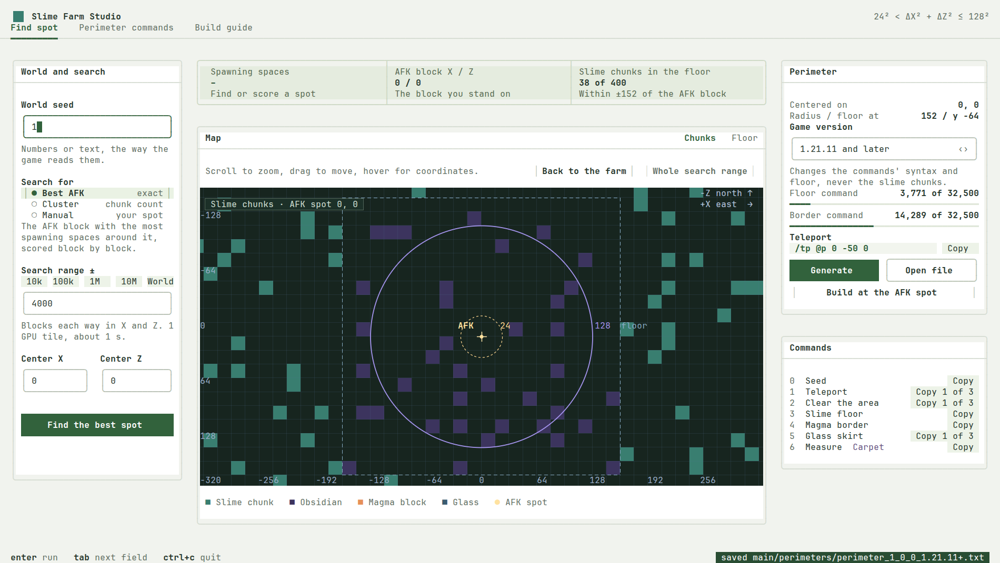

# Slime Farm Finder

Finds the best spot for a Minecraft slime farm on a world seed — the AFK block with the most
spawning spaces around it — then writes the commands that build the perimeter.

## Slime Farm Studio

The app, full screen in your terminal: seed in, best spot out, a live slime-chunk map, the
perimeter commands with Copy buttons, and the build guide.

- **Windows:** download `SlimeFarmStudio.exe` from [Releases](../../releases), put it in
  `slime_toolchain` next to the tools from `build.ps1`, and double-click it.
- **Linux / macOS:** `./build.sh`, then `./slime gui`.

The map is a real picture in Windows Terminal 1.22+, Ghostty, kitty, WezTerm and iTerm2;
other terminals draw it with characters.

## The rest

The search itself runs on the GPU (CUDA). Build first, then see:

- `slime_toolchain/HOW_TO_USE.txt` — the one-page version
- `slime_toolchain/README.txt` — every command, in order
- `slime_toolchain/LINUX.md` — running it on Linux
